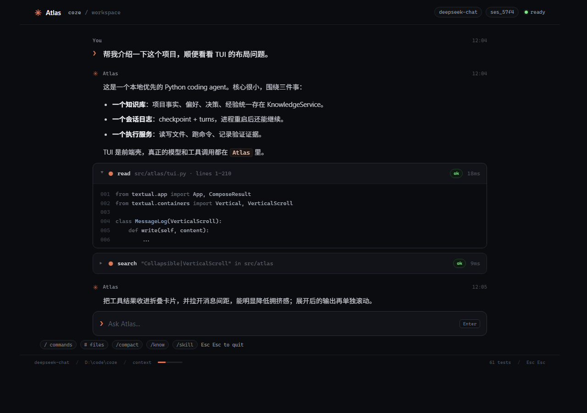

# Lean Atlas (Python MVP)

A small, local-first coding agent core built around three ideas:

1. **One knowledge store** for facts, preferences, decisions, lessons, docs and commands.
2. **One session journal** for recovery, checkpoints and audit.
3. **One execution service** for tools, sandboxed commands, tests and evidence.

This is the **M0/M1 Python implementation** of the Lean Atlas v1 spec. It is intentionally
small: no multi-tenant server, no multi-repo, no self-modifying code.

> Full plan: [Lean Atlas v1](docs/lean-atlas-v1.md) · [M0 task board](docs/m0-task-board.md) · [Maturity roadmap](docs/atlas-maturity-roadmap.md)

---

## Quickstart

Requires Python 3.10+.

```bash
pip install -e ".[dev]"
atlas init --path .
atlas doctor
atlas demo
atlas                  # full-screen TUI in a terminal
atlas chat "explain this repo"   # plain one-shot / REPL
atlas tui              # explicit TUI entry point
```

`atlas` is the CLI and does **not** need `atlas serve`. The HTTP daemon is only
for the VS Code extension or another JSON-RPC client.

`atlas demo` runs a complete offline task in a temporary repo:

1. reads a buggy `calc.py`;
2. writes/runs a failing test (red);
3. fixes the bug;
4. runs the test again (green);
5. records verification evidence;
6. writes and searches project knowledge.

No API key is needed for the demo.

---

## Use a real model

Edit `atlas.yaml`:

```yaml
model:
  provider: openai-compatible
  name: qwen-plus
  api_base: https://dashscope.aliyuncs.com/compatible-mode/v1
  api_key_env: DASHSCOPE_API_KEY
```

Then:

```bash
export DASHSCOPE_API_KEY=sk-...
atlas
```

Any OpenAI-compatible `/chat/completions` endpoint works (OpenAI, DashScope compatible
mode, DeepSeek, vLLM, Ollama, ...). For DeepSeek:

```yaml
model:
  provider: openai-compatible
  name: deepseek-chat
  api_base: https://api.deepseek.com
  api_key_env: DEEPSEEK_API_KEY
```

```bash
export DEEPSEEK_API_KEY=sk-...
atlas
```

### Terminal UI

`atlas` in a real terminal opens a full-screen Textual UI (opencode-style entry
point). Piped/non-TTY use falls back to the plain `atlas chat` loop.

| Command | Meaning |
|---|---|
| `/help` | command help |
| `/compact` | summarize old context, keep a recent tail |
| `/new` | start a new session |
| `/session` | switch session with ↑/↓ + Enter |
| `/know [query]` | list or search project memory |
| `/skill list` | list installed skills |
| `/skill install <path-or-url>` | install a Markdown skill |
| `/skill remove <name>` | remove a skill |
| `/doctor` | show doctor JSON |
| `/knowledge <query>` | search project knowledge |
| `/clear` | clear the screen |
| `/exit` | quit |

Type `/` to open the command menu (↑/↓ + Enter). Type `#` to open a workspace
file menu; selecting a file inserts `#path` and attaches its contents (bounded to
40k chars) to the next message. Press `Esc` once to close a menu, or `Esc Esc` to
quit.

Keys: `Ctrl+N` new session, `Ctrl+Q` quit, `F1` help, `Esc Esc` quit.

The TUI streams assistant text through the OpenAI-compatible SSE path. Tool
calls are shown as collapsed cards; while a tool is running its title shows a
spinner, and clicking the card expands the result. The transcript is a
scrollable log, and long tool output scrolls inside the expanded card.
`/session` opens a keyboard-selectable session picker (↑/↓ + Enter); the first
user message becomes the session title, and selecting a session restores its
user/assistant transcript in the chat view.
`/compact` asks the configured model to summarize older messages and saves the
reduced checkpoint. `/skill install` accepts a local `SKILL.md` or an http(s)
URL; installed skills are listed in the system prompt and loaded on demand.

Try the bundled example:

```text
/skill install examples/skills/code-review.md
```

> The AgentScope `Agent`/`Toolkit` adapter is available but still experimental. It has
> been exercised with a fake model, a local OpenAI-compatible streaming server, and a
> real DeepSeek `deepseek-chat` run with streaming on and off. Prior user/assistant
> text turns are restored when you pass `sessions=atlas.sessions`; tool-call history
> replay and middleware are still pending.

### Interactive web prototype

There is also a self-contained interactive web prototype at
[`design/atlas-ui.html`](design/atlas-ui.html). It supports:

- sending messages and watching the reply stream in;
- session history in `localStorage` (new/switch/search/delete);
- per-reply process detail: plan, tool calls, read/search results, edit diffs,
  check output and recalled knowledge;
- context and knowledge tabs, command/file palettes, stop, export and mobile layout.

Previews: [chat](design/atlas-ui-preview.png) · [process detail](design/atlas-ui-chat.png) ·
[mobile](design/atlas-ui-mobile.png). The prototype deliberately runs a local
simulation; wiring the same UI to the real daemon (streaming JSON-RPC + CORS) is
the next step. Open the file directly in a browser — no build step is needed.



---

## Commands

```bash
atlas init [--path .] [--name NAME]
atlas doctor
atlas demo [--keep]
atlas                    # TUI when stdin is a TTY, otherwise chat
atlas tui [--path .]     # explicit full-screen TUI
atlas chat [--session ID] [message ...]
atlas session list
atlas knowledge search "pytest"
atlas knowledge add --title "Test command" --body "python -m pytest -q" --kind command
atlas knowledge validate kn_xxx --note "replayed in tests"
atlas curator run [--llm] [--replay]
atlas serve --port 8765
atlas eval [--repeat 2]
```

`atlas eval` runs 10 small golden tasks in isolated temp repos. Every task is
validated to start red; a deterministic solver is covered by tests for the
`calc_add` task, and `--repeat` records multiple attempts. A historical DeepSeek
run reported 10/10, but it is not reproducible offline and is not a standing
claim. Use `atlas demo` for the offline end-to-end check.

`atlas curator run` is deterministic by default. `--llm` asks the configured model
for root-cause/prevention and falls back to the deterministic template when the
model is missing or returns unusable JSON. `--replay` re-runs the recorded failed
command and promotes a candidate only when it now passes. Lessons stay
`candidate` until a validation/replay step promotes them; `atlas knowledge
validate` requires a human note, and the agent-facing tool requires replay/test
evidence.

The daemon exposes `POST /rpc` (JSON-RPC 2.0) and `GET /health`:

```bash
curl -s http://127.0.0.1:8765/health
curl -s -X POST http://127.0.0.1:8765/rpc \
  -H 'Content-Type: application/json' \
  -d '{"jsonrpc":"2.0","id":1,"method":"doctor"}'
```

Set `ATLAS_TOKEN` (or `--token`) to require `Authorization: Bearer <token>`.
Binding to a non-loopback host without a token is refused at startup.

## VSCode extension (M0)

Minimal client lives in [`extension/`](extension/README.md):

```bash
cd extension
npm install
npm run compile
# F5 in VSCode, or:
npx @vscode/vsce package
code --install-extension atlas-vscode-0.0.1.vsix
```

Commands: `Atlas: Chat`, `Atlas: Doctor`, `Atlas: Initialize Project`,
`Atlas: Start Local Server`, `Atlas: Set Token`. Tokens are stored in
`SecretStorage`; requests have a configurable timeout and stale session ids are
re-created automatically. It is still a shell; Webview/diff/plan/task panels are next.

---

## What is implemented

| Area | Status |
|---|---|
| SQLite schema (15 tables) | ✅ |
| Session / turn / event / checkpoint | ✅ |
| Knowledge store + FTS5 search + lifecycle | ✅ |
| 12-tool surface | ✅ 10 real, 2 stubs (lsp/subagent); web search not enabled |
| Workspace path guard + sensitive paths | ✅ `.git`/`.atlas`/secrets denied; skills readable |
| Dangerous-command deny list | ✅ basic; shell env secrets are scrubbed |
| Test/lint/check + verification evidence | ✅ `check` results are recorded in `verifications` |
| OpenAI-compatible chat loop | ✅ retries transient 5xx; `max_turns` raises `MaxTurnsExceeded` |
| Textual TUI (opencode-style entry) | ✅ streaming, spinner tool cards, session picker, scrollable transcript |
| Skills (local/URL `SKILL.md` install) | ✅ descriptions in prompt; loaded on demand; private URLs denied |
| Context compaction (`/compact`) | ✅ model summary + reduced checkpoint; summary is pinned |
| Offline end-to-end demo | ✅ |
| Curator (deterministic consolidation/report; optional LLM RCA; `--replay`) | 🟡 replay + single-flight; idle scheduler pending |
| JSON-RPC HTTP daemon (`/rpc`, `/health`) | ✅ per-session lock; auth on non-loopback |
| Eval harness (10 tasks; repeatable; red baseline) | 🟡 historical 10/10 claim not reproducible offline |
| VSCode extension shell | 🟡 chat/doctor/init/server/token; no panels |
| AgentScope adapter | 🟡 experimental; fake/local/real DeepSeek; text-turn restore; tool-history/middleware pending |
| Multi-repo / team server | ⏳ later |

Tools currently available:

`read`, `edit`, `search`, `shell`, `git`, `check`, `knowledge`, `plan`, `ask_user`,
`web` (fetch only). `lsp` and `subagent` return a clear "not available in this milestone"
message; they are placeholders for M1/M2. `read` is bounded to 400 lines or 12,000
characters per call and returns `next_start` when there is more; the model-facing
result budget is `tools.result_max_chars` (default 16,000). In `default` permission
mode, read-only actions (`knowledge search/get`, `git status/diff/log/show/rev-parse`,
`plan read`) do not prompt; writes do. `web` re-checks every redirect target and
rejects private/loopback URLs.

---

## Knowledge model

One `knowledge_items` table:

- `scope`: `user` / `project` / `org`
- `kind`: `preference` / `fact` / `decision` / `lesson` / `doc` / `command` / `contract` / `assumption` / `glossary`
- `status`: `candidate` / `active` / `stale` / `retired` / `quarantined`

This replaces three separate systems (`MemoryService`, `LessonStore`, `ProjectKnowledgeBase`).
`scope` decides isolation. `kind` is a classification; `lesson` requires a passed
validation before it can be `active`, while preference/decision confirmation
policies are still M1. `atlas knowledge validate` requires a human note.

### Recall and capture (ADR-0004)

- Before each model call, `build_system_prompt(..., query=user_message)` calls
  `KnowledgeService.recall(limit=20)`. Retrieval uses FTS5 candidates plus
  `knowledge_chunks` lexical matches (hybrid), then ranks by relevance ×
  confidence × freshness × severity, applies per-kind token budgets (CJK-aware)
  and injects citations such as `[kn_ab12] fact · source:file:README.md`.
- Empty queries fall back to the recent active window (used by tests/tools).
- `knowledge` tool writes from the agent are candidates for
  `fact/preference/decision/assumption/lesson`; CLI `atlas knowledge add` remains a
  human write. `check` evidence is recorded in `verifications`.
- At turn end, explicit correction/preference phrases (`不对`, `以后`, `记住`,
  `prefer`, `remember`, ...) are captured as a **candidate fact** with a
  session/turn source. Controlled by `learning.capture: off | candidate`.
  Capture never writes active knowledge and never makes an extra model call.
- `feedback` cannot revive a quarantined/candidate item; promotion requires
  validation. Agent promotion requires `replay:`/`test:` evidence; manual
  promotion is a CLI/human action.
- `consolidate()` also ages out unused lessons (90 days without recall) and
  expired assumptions; file-backed `doc/command/contract` sources are hashed by
  `refresh_sources()`, and a changed file marks the item stale.
- `doctor` reports knowledge counts by status/kind.
- Writes reject likely secret material (API keys/private keys) and carry a
  `trust` level; untrusted items are excluded from recall by default.
- Write paths are transactional (item + chunks + FTS).
- Source hash refresh covers file-backed `doc/command/contract`; generic TTL for
  facts/commands/contracts is implemented in `consolidate()`, and Curator has a
  per-run LLM budget. Idle scheduling, semantic/LLM extraction and Review UI remain
  deferred; see ADR-0004.

### Budgets and cost

`model.max_turns` is a hard cap on LLM calls per turn (ADR-0002). `max_tool_calls`
caps tool executions independently. Optional `input_cost_per_1m` /
`output_cost_per_1m` prices make `usage.cost_usd` meaningful; `max_cost_usd`
stops a session before the next model call once the recorded cost is reached.

---

## Optional: AgentScope adapter

The default M0 loop is OpenAI-compatible and has no AgentScope dependency. If you
want to run the same tools/knowledge through AgentScope 2.x:

```bash
pip install "agentscope>=2.0"
export DASHSCOPE_API_KEY=sk-...
python examples/agentscope_smoke.py
```

See `src/atlas/agentscope_adapter.py`. It is experimental: it wraps the same 12
tools as `ToolBase` instances and runs one `Agent.reply` turn. In async code, call
`build_agent` and `await agent.reply(...)` directly; `run_once` is only a sync
wrapper. Tests cover tool roundtrips, the OpenAI-compatible streaming path, and a
real DeepSeek `deepseek-chat` run. Pass `sessions=atlas.sessions` to restore prior
user/assistant text turns and record new ones; tool-call history and middleware are
still on the M0 task board.

For DeepSeek, use AgentScope's OpenAI-compatible model:

```python
import os

from agentscope.credential import OpenAICredential
from agentscope.model import OpenAIChatModel

from atlas.agentscope_adapter import run_once

model = OpenAIChatModel(
    credential=OpenAICredential(
        api_key=os.environ["DEEPSEEK_API_KEY"],
        base_url="https://api.deepseek.com",
    ),
    model="deepseek-chat",
)
print(run_once(model, tools, atlas.config, session["id"], "read AGENTS.md"))
```

## Development

```bash
pytest -q
```

Install the package first (`pip install -e ".[dev]"`) so `atlas` is importable.

---

## Layout

```text
src/atlas/
  cli.py            # atlas init/doctor/demo/chat/knowledge/session
  orchestrator.py   # Atlas facade
  agent.py          # AgentRuntime + tool loop
  llm.py            # OpenAI-compatible client
  tools.py          # 12-tool registry
  workspace.py      # safe read/edit/search/shell/git/check
  knowledge.py      # unified knowledge service
  sessions.py       # sessions/turns/events/checkpoints
  db.py             # SQLite schema
  config.py         # atlas.yaml
  demo.py           # offline end-to-end demo
tests/
```

---

## Known limits (by design)

- Single repository, single user, local only.
- No multi-tenant server, SSO, RBAC, audit export.
- No self-evolution (L3–L6).
- No multi-repo/service graph.
- The 8-middleware architecture from `docs/lean-atlas-v1.md` is not implemented; the
  default loop is a small OpenAI-compatible runtime. AgentScope is an optional adapter.
- Plan approval/TestGate, the approval inbox, CodebaseService/LSP, task DAG and
  streaming JSON-RPC are deferred. `plan` writes a file; it does not gate execution.
- `permissions.mode: explore` is enforced (read-only tools, no edits/shell/git writes).
  `default` asks for approval before non-read-only tools and fails closed without an
  interactive callback; `accept_edits`/`dont_ask` skip the prompt. The full
  `permissions.allow/deny` rule engine is deferred.
- Automatic memory writeback is limited to conservative correction/preference
  capture as candidates (ADR-0004); semantic extraction and review UI are deferred.
- Curator is manual (`atlas curator run --replay`); it uses `jobs` for
  single-flight and a per-run LLM budget, but the idle/nightly scheduler and true
  per-night accounting (`learning.idle_minutes`, `learning.budget`) are not wired yet.
- Recall is hybrid lexical: FTS5 over item text plus `knowledge_chunks` term
  matching; there is still no vector/embedding index. Chunk hits carry
  `origin=chunk|hybrid` and a `chunk_id` for observability.
- `project.root` is honored, but `project.modules`, `style.profile`, `project.commands.setup`
  and the module graph are not consumed yet (CodebaseService is deferred).
- `shell` deny list is a guard, not a security boundary; use Docker for untrusted repos.
  It can read files accessible to the process (including `.env`) and access absolute
  paths outside the workspace; `read/edit/search` have the stricter path guard.
- `search` content mode rejects oversized and obvious nested-quantifier regexes and
  the scan is bounded by time, but Python regex can still backtrack on pathological
  patterns; prefer simple regexes.
- `web` fetch is basic HTML-to-text; private/loopback URLs and private redirect
  targets are rejected; no search provider.
- The TUI has basic collapsible tool cards; diff/plan panels and full interrupt handling are pending.
- The AgentScope adapter is experimental; text-turn restoration works, but tool-call history and middleware are pending.
- `atlas eval` uses visible fixture tests, not hidden acceptance tests; treat its
  pass rate as a smoke signal, not a benchmark.
- ADR-0002 (2026-11-18) changes `max_turns` to count LLM calls and raise
  `MaxTurnsExceeded`; this is a breaking behavior change.
- ADR-0004 adds task-aware recall and candidate capture; see
  [`docs/adr/ADR-0004-memory-recall-and-capture.md`](docs/adr/ADR-0004-memory-recall-and-capture.md).

The point of this milestone is to make the **durable core** runnable and testable before
adding more nouns. See `docs/atlas-maturity-roadmap.md` for the path from MVP to production.